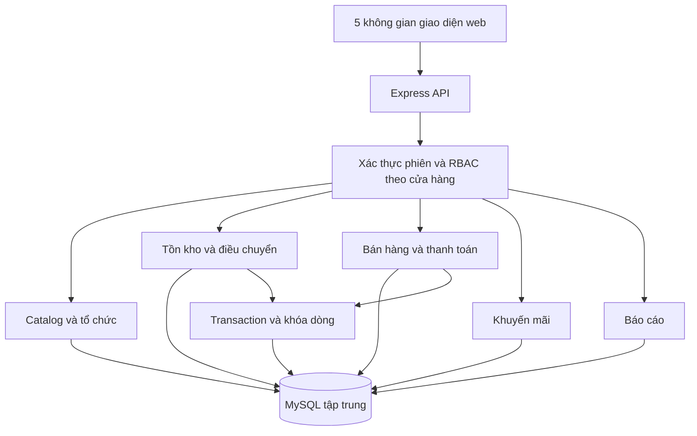
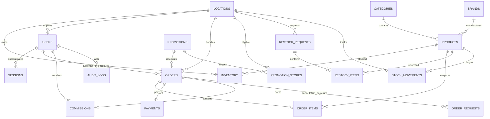
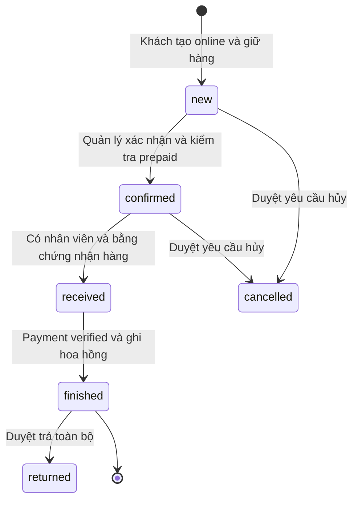
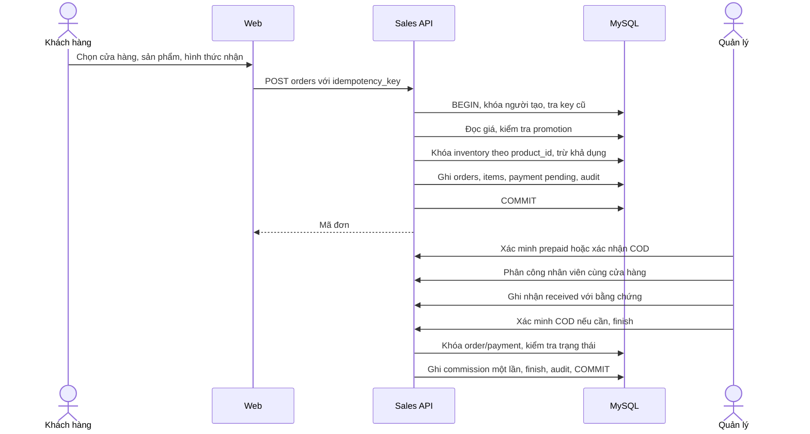
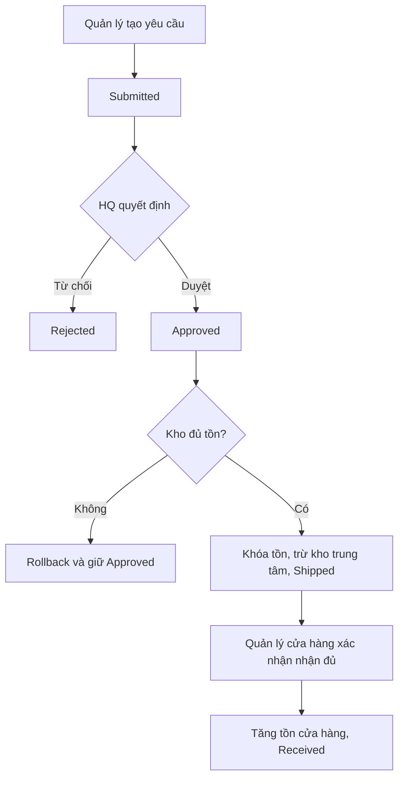

# Kiến trúc và thiết kế phiên bản 2.0

## Kiến trúc ứng dụng

Backend không tin giá, tổng tiền, role hoặc store_id của nhân viên do client tự khai. Role và phạm vi được tải từ session; các tuyến nhạy cảm kiểm tra lại quyền trên đối tượng. API chỉ cho khách xem đơn của họ, nhân viên xem đơn được phân công, quản lý xem cửa hàng được cấp quyền, HQ xem tổng thể. Nhà kho chỉ có nghiệp vụ kho trung tâm.

## ERD cốt lõi

Một hóa đơn offline được biểu diễn bằng order.channel=offline, code HD, status finished, payment verified. Đơn online code DH dùng cùng cấu trúc line items; không tạo hai nguồn doanh số. Tồn kho và biến động tách theo location. Thanh toán tách khỏi trạng thái đơn. UNIQUE(order_id) ở commissions ngăn ghi hoa hồng lặp. UNIQUE(created_by,idempotency_key) ở orders ngăn tạo đơn lặp.

Lược đồ vật lý đầy đủ: `database/schema.sql` và `database/schema-v2.sql`. `schema_migrations` đánh dấu khởi tạo v2. Các cột stock/min_stock cũ trong products chỉ làm nguồn seed lần đầu, không cập nhật khi vận hành.

## Máy trạng thái đơn và thanh toán

Payment dùng pending/verified/refunded. COD có thể confirmed khi pending, nhưng verify chỉ sau received. Card/QR phải verified trước confirmed. Hóa đơn offline tạo thẳng finished và verified sau xác nhận thu đủ. Đơn trả hàng giữ lịch sử, không xóa giao dịch.

## Sequence bán hàng online

## Activity bổ sung kho

## Đặc tả ca sử dụng trọng tâm

| Ca sử dụng | Tiền điều kiện | Luồng thành công | Ngoại lệ/hậu điều kiện |
| --- | --- | --- | --- |
| UC12 Bổ sung | Manager đã đăng nhập | Chọn dòng/số lượng; gửi; theo dõi trạng thái | Dòng không tồn tại/số lượng sai bị từ chối; không tăng tồn khi mới gửi |
| UC14 Xác nhận online | Manager đúng store; đơn new | Kiểm tra phương thức; verify prepaid; confirm | Không verify prepaid → 409; không thay đổi trạng thái |
| UC15 Phân công | Manager đúng store; new/confirmed | Chọn employee active cùng store | Khác store hoặc gán lại người khác → từ chối |
| UC16 Hoàn tất | Received; payment verified; có employee | Khóa order; ghi commission; finished; audit | Chưa thu COD → 409; thao tác lặp không tạo commission thêm |
| UC19 Hóa đơn offline | Employee/manager đã đăng nhập | Chọn hàng; confirm thu tiền; server tính giá/promo; stock+payment+commission cùng transaction | Bất kỳ dòng thiếu tồn → rollback toàn bộ |
| UC24 Đặt online | Customer đã đăng nhập; store active | Nhập thông tin; server giữ tồn và tạo order new/payment pending | Thiếu tồn → chọn cửa hàng khác; gửi lại cùng key trả đơn cũ |
| UC26 Hủy | Chính khách hoặc manager đúng store; new/confirmed | Tạo yêu cầu; manager approve/reject | Approve trả tồn; refund mô phỏng nếu đã verified; không xử lý hai lần |
| UC27 Trả | Đơn finished; quyền trên đơn | Tạo yêu cầu; manager kiểm tra toàn bộ hàng; approve | Transaction đổi status, trả tồn, refund mô phỏng, reverse commission |

## Tài liệu kỹ thuật tham khảo

- [MySQL locking reads](https://dev.mysql.com/doc/refman/8.0/en/innodb-locking-reads.html).
- [Playwright browser channels](https://playwright.dev/docs/browsers).
